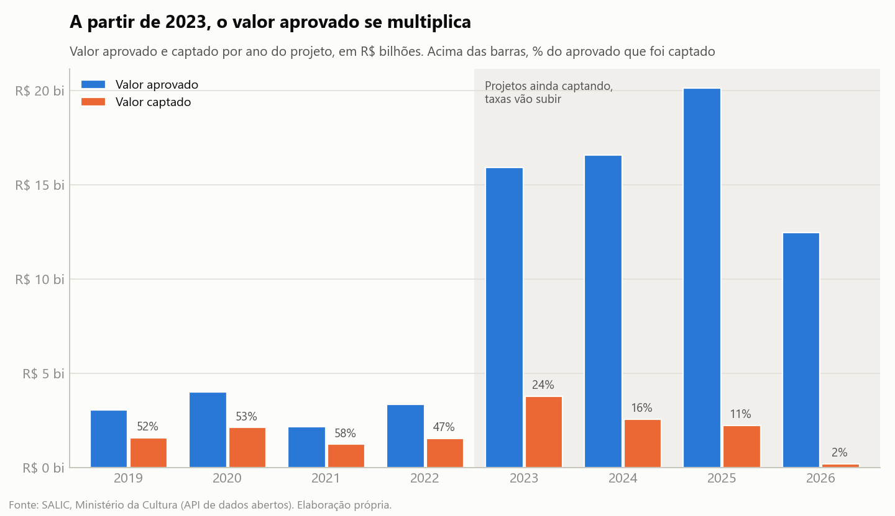
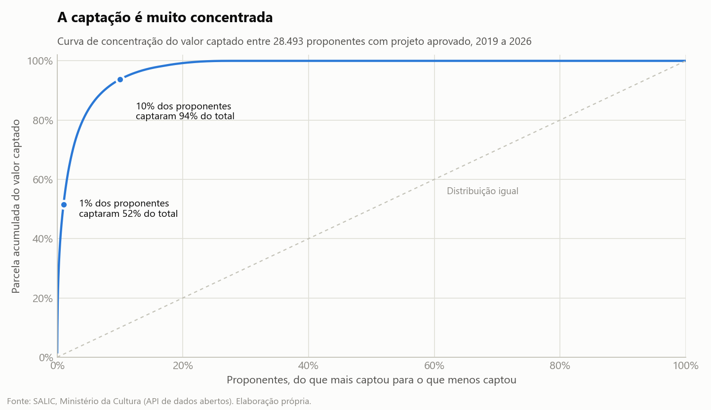
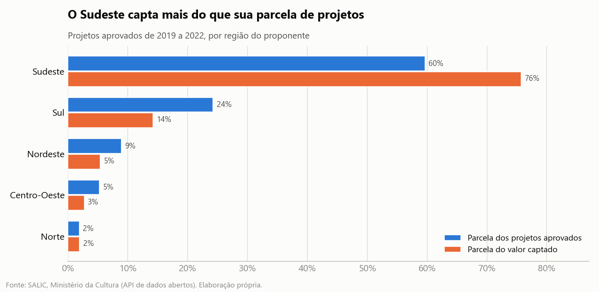

# Lei Rouanet em números

Quanto do dinheiro aprovado pela Lei Rouanet vira captação de fato, e quem consegue captar?

Análise dos 63.674 projetos registrados no SALIC entre 2019 e 2026, da coleta na API pública até os gráficos e a base para um painel em Power BI.

## Principais resultados

* **Metade do valor aprovado é captada.** Entre os projetos de 2019 a 2022, que já tiveram o prazo de captação encerrado, 52% do valor aprovado foi captado e 51% dos projetos captaram algum valor.
* **A captação é muito concentrada.** De 28.493 proponentes com projeto aprovado, 1% ficou com 52% de todo o valor captado e 10% ficaram com 94%. Outros 72% não captaram nada.
* **Empresas captam muito mais que pessoas físicas.** Pessoas jurídicas captaram 54% do valor aprovado, contra 20% das pessoas físicas e 29% dos MEIs.
* **O Sudeste capta mais do que sua parcela de projetos.** A região tem 60% dos projetos aprovados e 76% do valor captado. Sul, Nordeste e Centro-Oeste captam menos do que sua parcela.
* **Museus captam mais, festas e cultura popular bem menos.** Museus e memória captaram 68% do valor aprovado. Festas e cultura popular, 24%.
* **O valor aprovado se multiplicou a partir de 2023.** Passou de R$ 2 a 4 bilhões por ano para R$ 16 a 20 bilhões, sem crescimento equivalente da captação até agora.








Os maiores captadores no período são grandes instituições culturais do Sudeste, como a Fundação OSESP, o MASP, o Instituto Inhotim, o Instituto de Desenvolvimento e Gestão (IDG) e a Orquestra Sinfônica Brasileira. Cada uma captou entre R$ 179 e 249 milhões. A lista completa está em `resultados/top20_proponentes_pj.csv`.

## Fonte

API de dados abertos do SALIC, do Ministério da Cultura (`http://api.salic.cultura.gov.br/api/v1/projetos/`). A API devolve 34 campos por projeto, entre eles segmento, UF, município, proponente, situação e os valores solicitado, aprovado e captado. Ela só cobre projetos de 2019 em diante.

## Método

1. **Coleta** (`coletar_salic.py`). Download paginado da API, 100 projetos por página (o máximo aceito), com 6 conexões em paralelo, novas tentativas em caso de falha e retomada de onde parou. Cada página é guardada como JSON bruto compactado em `dados/brutos/` e nunca é editada.
2. **Limpeza** (`limpar.py`). Corrige nomes de campo com erro de digitação na API, completa o ano com 4 dígitos e cria colunas de análise.
   * Região, a partir da UF.
   * Área cultural, agrupando os 123 segmentos do SALIC em 10 áreas.
   * Etapa do projeto, agrupando as 71 situações em 8 etapas (em análise, captando, em execução, prestação de contas, encerrado sem captar etc.).
   * Tipo de proponente. A API mascara o CPF de pessoas físicas, e os MEIs aparecem com o CNPJ antes do nome.
   * Alertas para 36 projetos com valor aprovado negativo e 393 com captado acima do aprovado.
3. **Análise** (`analisar.py`). Tabelas em `resultados/`, gráficos em `figuras/` e a base do painel.

### Recorte de tempo

Um projeto aprovado tem cerca de dois anos para captar, com prorrogações. Em 2026, 94% dos projetos aprovados naquele ano ainda estavam captando, e em 2023 eram 25%. Comparar a taxa de captação de anos recentes com a de anos antigos daria a falsa impressão de queda. Por isso as comparações entre áreas, regiões e proponentes usam a coorte de 2019 a 2022, em que menos de 1% dos projetos ainda capta.

### Limitações

* A API não informa o incentivador (a empresa que patrocina), então não dá para analisar quem financia os projetos.
* Os valores estão em reais correntes, sem correção pela inflação.
* A classificação em áreas e etapas é própria, feita por regras sobre os textos do SALIC. As regras estão em `limpar.py`.

## Painel

Painel interativo em Power BI com quatro páginas (visão geral, território, áreas e proponentes) e filtros de ano, região, área e tipo de proponente. O projeto fica em `painel/Rouanet.pbip`, salvo em arquivos de texto e gerado pelo script `painel/gerar_pbip.py`. Detalhes e medidas DAX em [`painel/README.md`](painel/README.md).


## Como rodar

```bash
pip install -r requirements.txt
python coletar_salic.py --teste   # baixa só 2 páginas para conferir
python coletar_salic.py           # coleta completa, leva perto de uma hora
python limpar.py
python analisar.py
python painel/gerar_pbip.py       # depois abra painel/Rouanet.pbip e clique em Atualizar
```

No Windows com Miniconda, use `rodar_teste.bat` ou ative o ambiente antes (`conda activate base`). Sem isso o Python não encontra o módulo SSL.

Os dados brutos e tratados não ficam no repositório. Os scripts recriam tudo a partir da API. As tabelas de resultado e os gráficos ficam.
