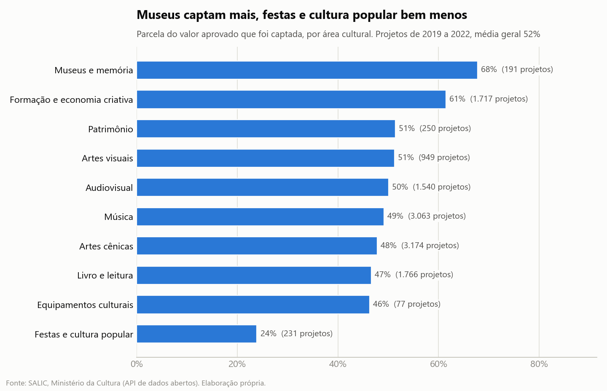
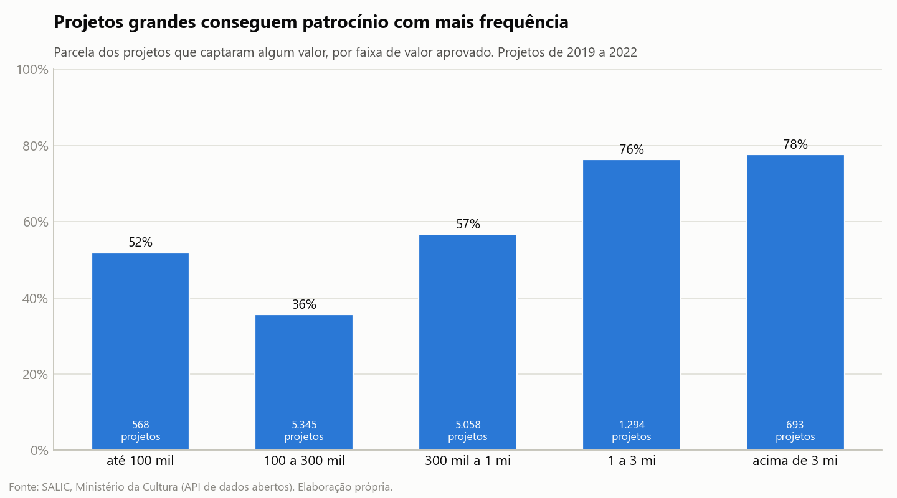
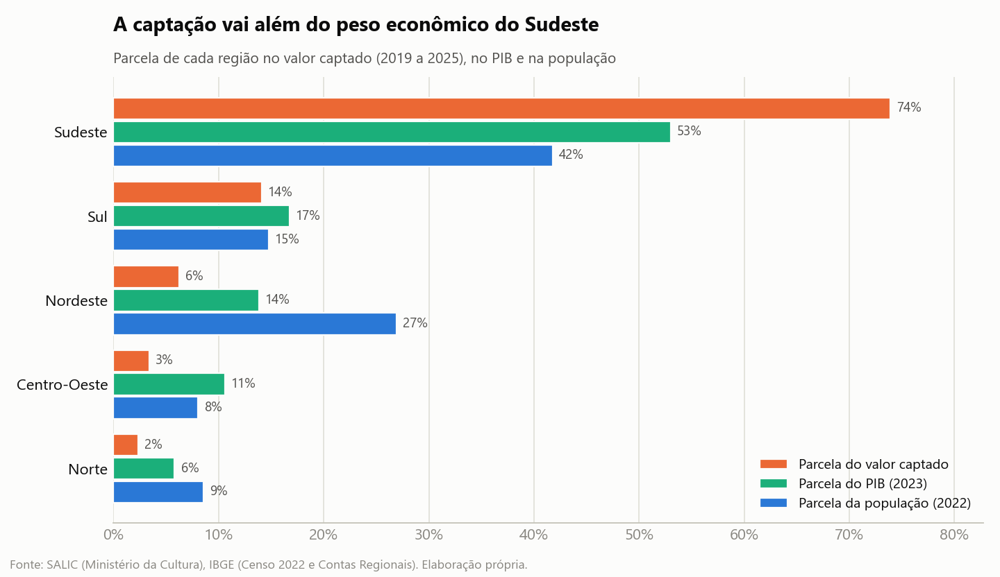
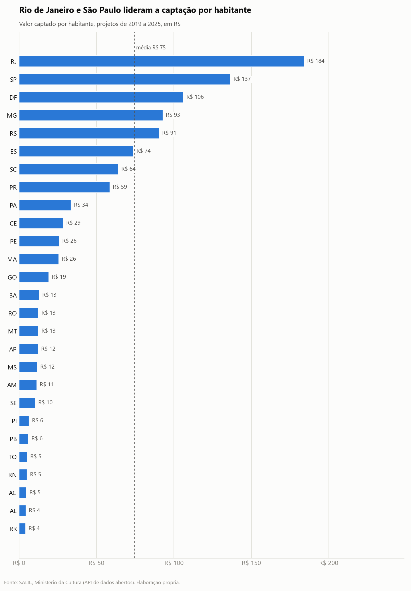
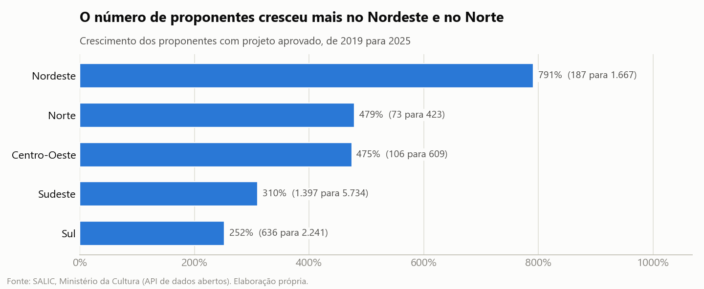
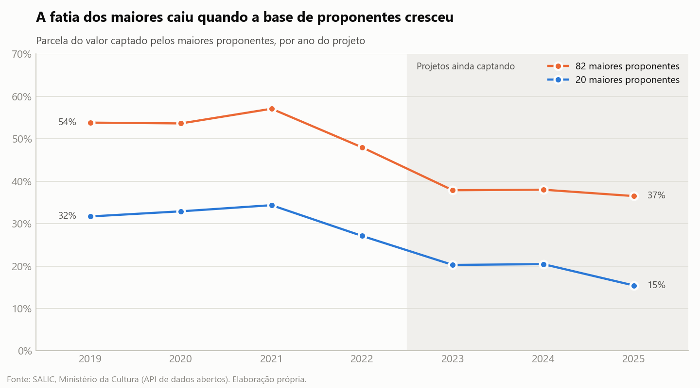
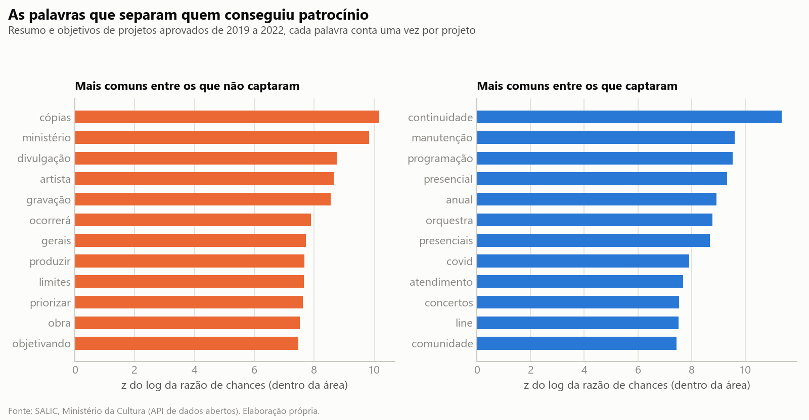
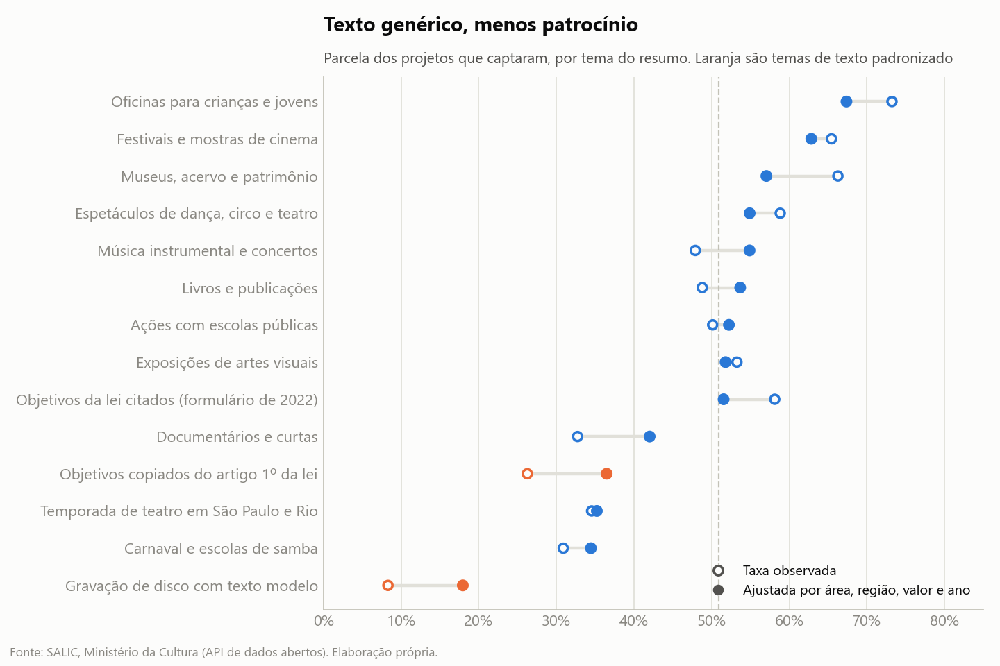
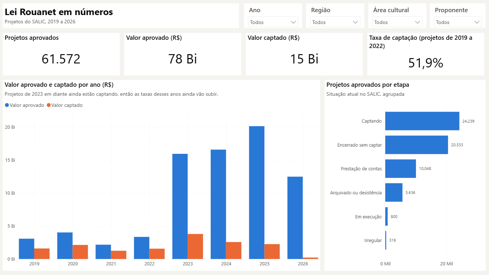
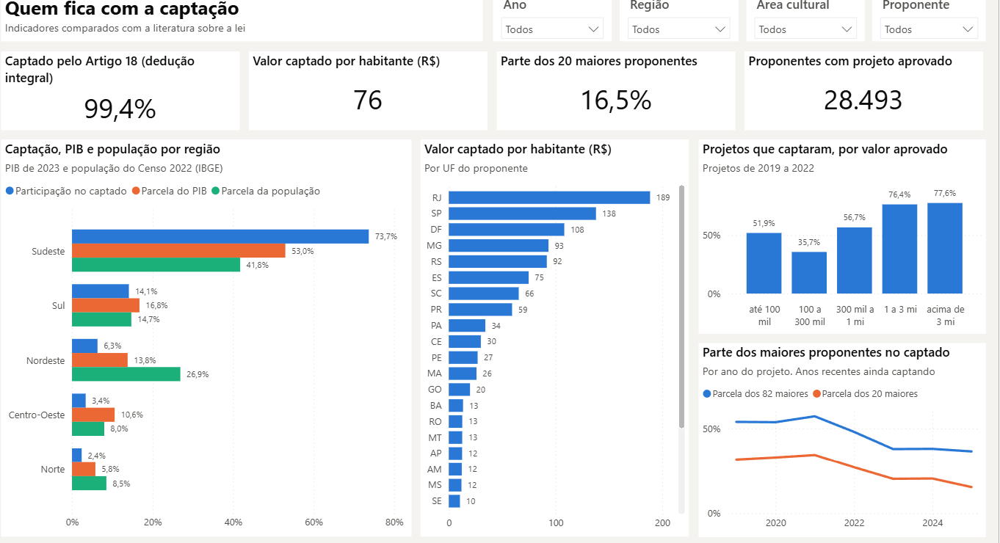

# Lei Rouanet em números

Quanto do dinheiro aprovado pela Lei Rouanet vira captação de fato, e quem consegue captar?

Análise dos 63.674 projetos registrados no SALIC entre 2019 e 2026, da coleta na API pública até os gráficos e a base para um painel em Power BI.

## Principais resultados

* **Metade do valor aprovado é captada.** Entre os projetos de 2019 a 2022, que já tiveram o prazo de captação encerrado, 52% do valor aprovado foi captado e 51% dos projetos captaram algum valor.
* **A captação é muito concentrada.** De 28.493 proponentes com projeto aprovado, 1% ficou com 52% de todo o valor captado e 10% ficaram com 94%. Outros 72% não captaram nada.
* **Empresas captam muito mais que pessoas físicas.** Pessoas jurídicas captaram 54% do valor aprovado, contra 20% das pessoas físicas e 29% dos MEIs.
* **O Sudeste capta mais do que sua parcela de projetos.** A região tem 60% dos projetos aprovados e 76% do valor captado. Sul, Nordeste e Centro-Oeste captam menos do que sua parcela.
* **Museus captam mais, festas e cultura popular bem menos.** Museus e memória captaram 68% do valor aprovado. Festas e cultura popular, 24%.
* **Quase tudo é renúncia integral.** 99,4% do valor captado entrou pelo Artigo 18, em que o patrocinador deduz 100% do imposto. Detalhes e comparação com a literatura na seção abaixo.
* **O valor aprovado se multiplicou a partir de 2023.** Passou de R$ 2 a 4 bilhões por ano para R$ 16 a 20 bilhões, sem crescimento equivalente da captação até agora.





Os maiores captadores no período são grandes instituições culturais do Sudeste, como a Fundação OSESP, o MASP, o Instituto Inhotim, o Instituto de Desenvolvimento e Gestão (IDG) e a Orquestra Sinfônica Brasileira. Cada uma captou entre R$ 179 e 249 milhões. A lista completa está em `resultados/top20_proponentes_pj.csv`.

## O que a literatura diz e o que os dados mostram

A Lei Rouanet é uma das políticas culturais mais estudadas e mais disputadas do país. Esta seção confronta as principais teses sobre ela com a base do SALIC. Os números saem de `analisar.py` e estão em `resultados/`.

### Dinheiro público, escolha privada

A crítica mais antiga à lei é que o Estado abre mão do imposto, mas quem decide o destino do dinheiro é o departamento de marketing da empresa patrocinadora. No Artigo 18 o patrocinador deduz 100% do valor do imposto de renda devido, e no Artigo 26 a dedução é parcial e a empresa coloca parte do próprio dinheiro. Na base, **99,4% do valor captado de 2019 a 2025 entrou pelo Artigo 18**. Na prática quase todo o mecanismo é renúncia fiscal integral, o que reforça o argumento de que a escolha é privada com dinheiro inteiramente público.

Essa lógica ajuda a explicar quem consegue captar. Projetos acima de R$ 1 milhão captaram algum valor em 76% a 78% dos casos, contra 36% na faixa de R$ 100 a 300 mil, onde está o maior número de projetos. Grandes instituições têm equipe de captação, marca conhecida e relação com patrocinadores. Os planos anuais, modalidade usada por instituições que mantêm programação contínua, ficaram com 20% de todo o valor captado.



### Concentração regional

Teixeira, Xavier e Faria (2024) estimam que o Sudeste concentrou perto de 80% da captação ao longo da história da lei, número próximo do apresentado à CPI da Lei Rouanet na Câmara em 2016. O Ministério da Cultura atribui parte disso ao fato de que só empresas tributadas pelo lucro real podem patrocinar, e elas se concentram no Sudeste.

Os dados de 2019 a 2025 confirmam a concentração, um pouco menor que a média histórica. **O Sudeste ficou com 73,9% do valor captado, com 53% do PIB e 42% da população.** O argumento do lucro real explica parte da distância, mas não toda, porque a região capta bem mais do que seu peso econômico. Norte e Nordeste somam 35,5% da população e 8,6% da captação. As capitais São Paulo e Rio de Janeiro, sozinhas, respondem por 51% do valor captado.

Por habitante, o Rio de Janeiro capta R$ 184 e São Paulo R$ 137, contra uma média nacional de R$ 75. Em 14 das 27 UFs a captação fica abaixo de R$ 15 por habitante.





### Desconcentração recente

O estudo da FGV encomendado pelo Ministério da Cultura (2026) registra que o número de proponentes cresceu 408% no Norte e 428% no Nordeste entre 2018 e 2024, contra 123% no Sudeste. Os dados do SALIC apontam na mesma direção. De 2019 para 2025, os proponentes com projeto aprovado no Nordeste passaram de 187 para 1.667 (alta de 791%) e no Norte de 73 para 423, contra alta de 310% no Sudeste.

A ressalva é que mais proponentes não significa mais dinheiro. A parcela do Nordeste no valor captado ficou entre 4% e 7% em todos os anos, e a do Sudeste caiu pouco, de 79% nos projetos de 2019 para 72% nos de 2025. A base cresceu mais rápido na ponta da aprovação do que na da captação.



### Poucos proponentes, muito dinheiro

Teixeira, Xavier e Faria (2024) mostram que 82 proponentes ficaram com cerca de 45% da captação de 2024 e 20 entidades com 28%. Aqui o recorte é por ano do projeto, não por ano da captação, então os números não são diretamente comparáveis. Nos projetos de 2019 a 2021, os 82 maiores proponentes captaram mais da metade do valor e os 20 maiores perto de um terço. Nos projetos de 2023 a 2025 essas parcelas caíram para perto de 37% e 15% a 20%. Parte da queda é real, porque o número de proponentes triplicou, mas parte vem de os projetos recentes ainda estarem captando.



### Impacto econômico

O mesmo estudo estimou que cada R$ 1 executado em projetos da lei movimentou R$ 7,59 na economia em 2024, com 228 mil postos de trabalho. A edição anterior, de 2018, falava em R$ 1,59. A diferença grande entre as duas vem em boa parte de mudanças de método, e um multiplicador de produção não é o mesmo que retorno para o Estado. Esta base não permite testar esses números, porque não traz gastos dos projetos nem dados de emprego.

### Prestação de contas

O TCU aponta um estoque de dezenas de milhares de projetos com prestação de contas pendente. Na base, 316 projetos aprovados estão em situação irregular (inadimplentes, com contas reprovadas ou em tomada de contas especial) e mais de 10 mil estão na etapa de prestação de contas. A API não informa a data em que cada etapa começou, então não dá para medir o atraso.

### Referências

* Teixeira, L. C., Xavier, W. S. e Faria, E. R. (2024). Distribuição geográfica de projetos culturais com captação de recursos via Lei Rouanet. *DRd, Desenvolvimento Regional em Debate*, v. 14, p. 556 a 578. [periodicos.unc.br](https://www.periodicos.unc.br/index.php/drd/article/view/5320/2274)
* Fundação Getulio Vargas (2026). Impacto econômico da Lei Rouanet. Estudo encomendado pelo Ministério da Cultura. [PDF divulgado pelo Poder360](https://static.poder360.com.br/2026/01/PESQUISA-ROUANET-fgv-1.pdf)
* Brasil de Fato (2026). Lei Rouanet gera empregos e impacto bilionário, mas Sul e Sudeste ainda concentram 86% dos projetos. [brasildefato.com.br](https://www.brasildefato.com.br/2026/01/13/lei-rouanet-gera-empregos-e-impacto-bilionario-mas-sul-e-sudeste-ainda-concentram-86-dos-projetos/)
* Câmara dos Deputados (2016). CPI da Lei Rouanet, apresentações em audiências públicas. [camara.leg.br](https://www2.camara.leg.br/atividade-legislativa/comissoes/comissoes-temporarias/parlamentar-de-inquerito/55a-legislatura/cpi-lei-rouanet/documentos/audiencias-publicas/ApresentacaoJucanaCPIv5.pdf)
* Congresso em Foco. Os números contraditórios da Rouanet não mentem. [congressoemfoco.com.br](https://www.congressoemfoco.com.br/artigo/115490/os-numeros-contraditorios-da-rouanet-nao-mentem)

## O que o texto dos projetos revela

Cada projeto tem um resumo e uma lista de objetivos escritos pelo proponente. Li esses textos dos 12.958 projetos aprovados de 2019 a 2022 (prazo de captação encerrado) para saber se o jeito de descrever o projeto tem relação com conseguir patrocínio. O código está em `textos.py`.

Primeiro comparei o vocabulário de quem captou e de quem não captou com o log da razão de chances com prior de Dirichlet informativo (Monroe, Colaresi e Quinn, 2008), feito dentro de cada área cultural para que uma palavra não pareça boa só porque a área dela capta mais. Quem captou fala de continuidade, manutenção, programação anual, atendimento e comunidade, o vocabulário de instituições que já funcionam (museus, orquestras, festivais com várias edições). Quem não captou fala de produzir uma obra, gravação, artista e divulgação, e repete trechos de formulário como "ocorrerá de maneira ampla" e "respeitando os limites".



Depois um modelo de tópicos (NMF) separou os resumos em 14 temas, que nomeei lendo as palavras e uma amostra de textos de cada um. Para cada tema calculei a taxa de captação observada e a taxa ajustada por regressão logística, mantendo área, região, faixa de valor e ano. Oficinas para crianças e jovens, festivais de cinema e museus ficam acima de 57% mesmo depois do ajuste. Dois temas não são definidos pelo conteúdo, e sim por texto padronizado. Os projetos que copiam os objetivos do artigo 1º da lei captam 26% (36% ajustado), e os de gravação de disco escritos sobre um mesmo modelo captam 8% (18% ajustado), contra 51% na média.



O resultado é uma associação, não um efeito do texto. Texto genérico provavelmente indica proponentes com menos estrutura e menos contato com empresas, e é isso que pesa na hora de captar. Para quem decide patrocínio, o texto serve como sinal rápido de maturidade do proponente. Para quem escreve projetos, a lição é descrever o que vai acontecer, para quem e com que continuidade.

* Monroe, B. L., Colaresi, M. P. e Quinn, K. M. (2008). Fightin' Words. Lexical feature selection and evaluation for identifying the content of political conflict. *Political Analysis*, 16(4), p. 372 a 403.

## Fonte

API de dados abertos do SALIC, do Ministério da Cultura (`http://api.salic.cultura.gov.br/api/v1/projetos/`). A API devolve 34 campos por projeto, entre eles segmento, UF, município, proponente, situação e os valores solicitado, aprovado e captado. Ela só cobre projetos de 2019 em diante. População (Censo 2022, tabela 4709) e PIB por UF (2023, tabela 5938) vêm do SIDRA, do IBGE, e são baixados por `analisar.py`.

## Método

1. **Coleta** (`coletar_salic.py`). Download paginado da API, 100 projetos por página (o máximo aceito), com 6 conexões em paralelo, novas tentativas em caso de falha e retomada de onde parou. Cada página é guardada como JSON bruto compactado em `dados/brutos/` e nunca é editada.
2. **Limpeza** (`limpar.py`). Corrige nomes de campo com erro de digitação na API, completa o ano com 4 dígitos e cria colunas de análise.
   * Região, a partir da UF.
   * Área cultural, agrupando os 123 segmentos do SALIC em 10 áreas.
   * Etapa do projeto, agrupando as 71 situações em 8 etapas (em análise, captando, em execução, prestação de contas, encerrado sem captar etc.).
   * Tipo de proponente. A API mascara o CPF de pessoas físicas, e os MEIs aparecem com o CNPJ antes do nome.
   * Alertas para 36 projetos com valor aprovado negativo e 393 com captado acima do aprovado.
3. **Análise** (`analisar.py`). Tabelas em `resultados/`, gráficos em `figuras/` e a base do painel.

### Recorte de tempo

Um projeto aprovado tem cerca de dois anos para captar, com prorrogações. Em 2026, 94% dos projetos aprovados naquele ano ainda estavam captando, e em 2023 eram 25%. Comparar a taxa de captação de anos recentes com a de anos antigos daria a falsa impressão de queda. Por isso as comparações entre áreas, regiões e proponentes usam a coorte de 2019 a 2022, em que menos de 1% dos projetos ainda capta.

### Limitações

* A API não informa o incentivador (a empresa que patrocina), então não dá para analisar quem financia os projetos.
* Os valores estão em reais correntes, sem correção pela inflação.
* A classificação em áreas e etapas é própria, feita por regras sobre os textos do SALIC. As regras estão em `limpar.py`.

## Painel

Painel interativo em Power BI com cinco páginas (visão geral, território, áreas, proponentes e desigualdade) e filtros de ano, região, área e tipo de proponente. O projeto fica em `painel/Rouanet.pbip`, salvo em arquivos de texto e gerado pelo script `painel/gerar_pbip.py`. Detalhes e medidas DAX em [`painel/README.md`](painel/README.md).



A página de desigualdade reúne os indicadores da comparação com a literatura.



## Como rodar

```bash
pip install -r requirements.txt
python coletar_salic.py --teste   # baixa só 2 páginas para conferir
python coletar_salic.py           # coleta completa, leva perto de uma hora
python limpar.py
python analisar.py
python textos.py                  # análise do texto dos projetos, perto de um minuto
python painel/gerar_pbip.py       # depois abra painel/Rouanet.pbip e clique em Atualizar
```

No Windows com Miniconda, use `rodar_teste.bat` ou ative o ambiente antes (`conda activate base`). Sem isso o Python não encontra o módulo SSL.

Os dados brutos e tratados não ficam no repositório. Os scripts recriam tudo a partir da API. As tabelas de resultado e os gráficos ficam.
