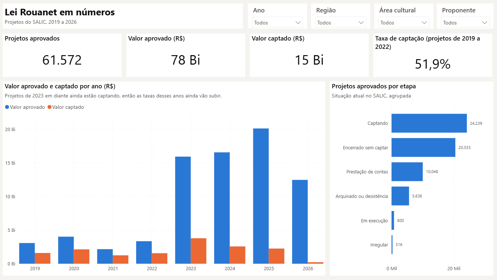

# Painel em Power BI

O painel fica em `Rouanet.pbip`, um projeto do Power BI salvo em arquivos de texto. O modelo de dados está em TMDL (`Rouanet.SemanticModel`) e o relatório em PBIR (`Rouanet.Report`). Assim o painel tem histórico no git como qualquer código, e cada mudança aparece no diff.

Os arquivos são gerados por `gerar_pbip.py`. Para mudar o painel, edite o script e gere de novo.

## Como abrir

1. Rode `python limpar.py` e depois `python analisar.py`, que criam a base `dados/painel/projetos_powerbi.csv`.
2. Rode `python painel/gerar_pbip.py`. O script grava o caminho da base no parâmetro `PastaDados` do modelo.
3. Abra `painel/Rouanet.pbip` no Power BI Desktop e clique em Atualizar. Os dados carregam em uns 10 segundos.

O Power BI Desktop é gratuito e não precisa de conta para abrir, editar e salvar o painel. A conta só é necessária para publicar na web.

## Páginas

| Página | Conteúdo |
|---|---|
| Visão geral | Cartões com projetos aprovados, valor aprovado, valor captado e taxa de captação. Colunas de valor aprovado e captado por ano e barras por etapa do projeto |
| Território | Valor captado por UF, tabela de indicadores por região e taxa de captação por região |
| Áreas e segmentos | Taxa de captação por área cultural e tabela com todos os segmentos |
| Proponentes | Taxa de captação e parcela de projetos que captaram por tipo de proponente, e tabela dos maiores captadores |

Todas as páginas têm filtros de ano, região, área cultural e tipo de proponente no topo.

## Medidas DAX

| Medida | Fórmula |
|---|---|
| Projetos aprovados | `CALCULATE ( COUNTROWS ( projetos ), projetos[aprovado] = TRUE () )` |
| Valor aprovado | `CALCULATE ( SUM ( projetos[valor_aprovado] ), projetos[aprovado] = TRUE () )` |
| Valor captado | `CALCULATE ( SUM ( projetos[valor_captado] ), projetos[aprovado] = TRUE () )` |
| Taxa de captação | `DIVIDE ( [Valor captado], [Valor aprovado] )` |
| % que captaram | `DIVIDE ( CALCULATE ( [Projetos aprovados], projetos[captou] = TRUE () ), [Projetos aprovados] )` |
| Participação no captado | `DIVIDE ( [Valor captado], CALCULATE ( [Valor captado], ALLSELECTED ( projetos ) ) )` |

Cada medida de captação tem uma versão 2019-2022, que filtra `projetos[ano] <= 2022`. Projetos de 2023 em diante ainda estão captando, então a taxa desses anos ainda vai subir. Por isso as comparações entre áreas, regiões e proponentes usam só os projetos de 2019 a 2022, como na análise em Python. O cartão de taxa da visão geral também usa esse recorte e mostra 51,9%.
